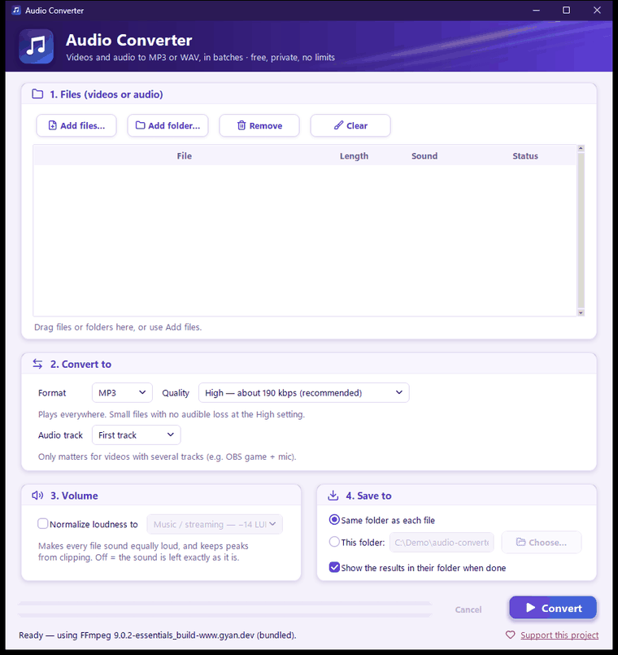

# Audio Converter

**Free, offline alternative to online audio converters. No upload limits, no ads, no account.**



Pulls the sound out of videos, or converts audio files, to **MP3** or **WAV**, a whole batch at
a time, and can make them all equally loud. Your files never leave your computer. Works on
Windows and macOS.

## Download
Get the latest version from the [Releases page](https://github.com/collinb0607/audio-converter/releases/latest).
Nothing else to install: FFmpeg is built in.

| Your computer | Download | First launch |
|---|---|---|
| Windows 10/11 | `Audio-Converter-Windows.exe` | Windows may show "Windows protected your PC" because the app isn't signed. Click **More info**, then **Run anyway**. The first start takes a few seconds. |
| Mac with Apple Silicon (M1 or newer) | `Audio-Converter-macOS.zip` | Unzip, then open **Audio Converter**. macOS blocks it the first time because the app isn't notarized: open **System Settings → Privacy & Security**, scroll down and click **Open Anyway**. |

On an Intel Mac, or any other system, run it from source with Python (below).

## How it works
- **Batches.** Add files or a whole folder (the files directly inside it). Each file shows its
  length, sound format and progress. Files with no sound, or damaged files, are skipped with the
  reason, and the rest carry on.
- **Equal loudness, not just "louder".** Normalizing measures how loud each file *sounds* (in LUFS,
  the standard Spotify, YouTube and podcast apps use), then applies one steady volume change, so
  nothing pumps or sounds squashed. Results land within about 1 LU of the target. Peaks are held
  under −1 dBTP so nothing clips: each finished MP3 is measured, and turned down a little if MP3
  encoding pushed its peaks too high. Peak safety wins over hitting the loudness exactly.
- **Keeps what it should.** The sample rate (MP3 tops out at 48 kHz), mono or stereo, and tags
  like title and artist are kept.
- **Safe with your files.** It never overwrites the original: converting `song.mp3` to MP3 in the
  same folder makes `song (converted).mp3`. If outputs already exist it asks once for the whole
  batch: replace, skip those, or stop. Each file is written under a temporary name and renamed when
  it's finished, so Cancel or a crash never leaves half a file or damages one being replaced.

## Options
| Option | What it does |
|---|---|
| Format / Quality | **MP3**: High (about 190 kbps VBR, no audible loss for most people), Highest (320 kbps) or Smaller (128 kbps). **WAV**: 16-bit (CD quality) or 24-bit (for editing). |
| Audio track | For videos with several sound tracks (OBS can record game, mic and Discord separately): use the **first track**, or **mix all tracks** into one. |
| Normalize loudness | Off by default, so the sound is left exactly as it is. Targets: **−14 LUFS** (music, streaming), **−16 LUFS** (podcasts, voice) or **−23 LUFS** (broadcast, EBU R128). |
| Save to | Next to each original, or all in one folder. Two inputs with the same name (e.g. `clip.mp4` and `clip.mov`) become `clip.mp3` and `clip (2).mp3`. |
| Show the results | Opens the output folder when the batch is done. |

## Run from source (Python)
### Setup (one time)
1. Install **Python 3.8+** from https://python.org. On Windows, tick **"Add Python to PATH"** during install.
2. Run the app (see below). The first time, it asks **"Install FFmpeg?"** Click **Yes**. It downloads
   `imageio-ffmpeg`, which includes FFmpeg (about 30 MB). You won't be asked again.

### Run
```
python audio_converter.py        # Windows
python3 audio_converter.py       # macOS
```
On Windows you can also double-click `audio_converter.py`. If you have more than one Python
installed, double-clicking can run a different one from `python` in a terminal, so it may ask to
install FFmpeg once more. The install dialog shows which Python it installs into.

## Troubleshooting
- **"No sound in this file":** the video has no audio track (some screen recorders leave it out).
- **A normalized file is a bit quieter than the target:** its peaks would have gone over −1 dBTP at
  full loudness, so it was turned down just enough to stay clean. This happens most with
  **Smaller — 128 kbps** MP3s; the High setting needs less correction.
- **Album art isn't copied** to the new file. Title, artist and other tags are.
- **Something fails with no message:** errors are also written to `audio_converter_errors.log`
  in your temp folder. On Windows, paste `%TEMP%\audio_converter_errors.log` into File Explorer's
  address bar. On Mac, run `open $TMPDIR/audio_converter_errors.log`.

## Part of the Offline Toolkit
Also by me: [GIF Maker](https://github.com/collinb0607/gif-maker), which turns a video into a GIF,
animated WebP, MP4 or WebM, and [Video Compressor](https://github.com/collinb0607/video-compressor),
which shrinks a video to fit Discord's upload limit or an email attachment.
